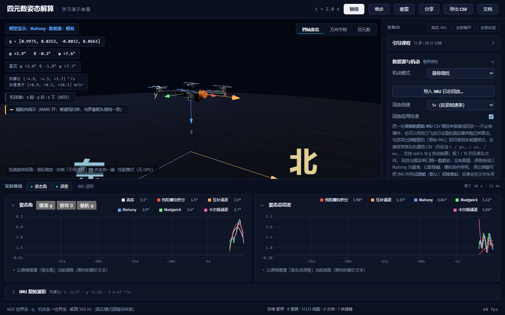
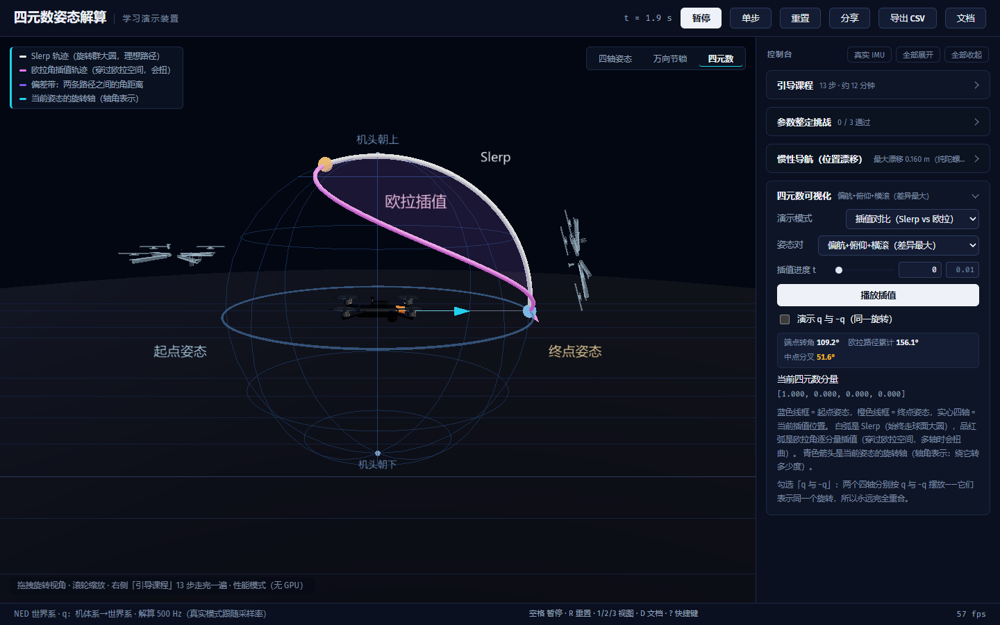

# Quaternion Attitude Estimation · A Learning Demo

**[Live demo](https://fly_web.070616.xyz)** · **[Source](https://github.com/liuxiangfan/fly-web)** · [简体中文](README.md)

Turns "quaternions, attitude estimation, Kalman filtering" from formulas on paper into a device you can drag sliders on:
five estimators run on the same IMU stream, three views show the same attitude three ways, and the curves plus the
evaluation table turn "who drifts, and by how much" into reproducible numbers.

Pure front end, no backend, no keys — every computation happens in the browser.



## What it is

A virtual quadcopter, a tunable IMU model, five attitude estimators, and a ground truth you can check frame by frame.
Change any IMU parameter (bias, noise, cross-axis, latency, sample rate, magnetic disturbance…) and the difference
between the five curves changes immediately — "why does this one diverge while that one converges" needs no guessing,
because the device ships with reproducible scenarios, exportable data, and frame-level comparison tools.

The in-app manual is designed for self-study on a desktop. Follow the attitude readout to the quaternion matrix derivation, look up a term and return to the same passage, or use a single roll observation to compare the Kalman gain with the resulting attitude correction.

## Features

- **Five estimators side by side** — pure gyro integration (the drift reference) · complementary filter · Mahony · Madgwick · ESKF, same data, same time base.
- **Three views** — quad attitude (with truth ghost and uncertainty ellipsoid) · gimbal lock (nested rings, lock visible) · quaternion (stereographic projection + Slerp comparison).
- **Three data sources** — a simulator with a tunable sensor model (ten manoeuvre scenarios) · raw IMU CSV replay · real hardware over Web Serial / Web Bluetooth, including MAVLink v2 RAW_IMU.
- **Calibration loop** — magnetometer sphere fit and full ellipsoid, accelerometer six-face calibration, held-out validation sets, device fingerprints and staleness warnings.
- **From attitude to position** — strapdown mechanisation draws the north-east drift, making the causal link between attitude error and position error visible.
- **Reproducible evaluation** — a seed drives noise and initial conditions; experiment archives export and import; multi-seed batch evaluation reports P50/P95 and non-convergence, runs in a Web Worker, and can be cancelled at any time.
- **Single-variable comparison** — freeze one configuration and seed, run A/B as two independent complete runs while changing only one declared variable; show the full config diff, B−A metrics and an exportable read-only report; a textbook claim button opens it directly.
- **Prediction exercises** — five "predict, run, compare" activities whose evidence comes from a fixed 5-second offline re-run, so a wrong intuition is directly contradicted by the measurements; the result panel exports a JSON record with prediction, evidence, verdict and reflection.
- **Task context and parameter feedback** — after loading an experiment or challenge, show the fixed conditions, the single variable, what to observe and the next step; parameter changes state their real effect layer and whether the run resets.
- **Observability and event timeline** — per-axis error, observation valid/rejected/applied states and conservative explanations; coarse alignment, gate rejection and recovery recorded as edges and clickable back to the curve time.
- **Historical review and ESKF step inspection** — bounded review frames recorded on demand, read-only override of the 3D display; ESKF can explicitly capture one update's prediction, observation, gating, gain and covariance changes (with an opt-in full 6×6 P matrix).
- **Evidence-first review navigation** — jump to the worst error frame and the neighbouring local peaks; the same frame shows real events within ±0.25 s, raw/consumed IMU and observation state; conservative explanations only, no root-cause guesses.
- **Read-only experiment reports** — one click in the diagnostics section builds a report with the config snapshot, all five estimators' metrics, events and comparison results; export as JSON or print it; a report JSON can be re-imported read-only, never applying config or touching the current run.
- **Three text sizes and offline resilience** — standard/large/x-large UI text (persisted locally, invalid values fall back); after the first online visit every lazily loaded feature works offline, and new versions appear as a confirmation banner instead of taking over silently.
- **Built-in textbook** — 15 pages, 19 chapters of mathematical derivation, a control manual, experiments and exercises, troubleshooting, terminology, and citations.
- **Accessibility** — full keyboard operation with focus restoration, text-table equivalents for the charts, colour-vision-friendly palette, collapsible navigation on narrow screens, and three UI text sizes.

## Quick start

**Requires Windows 10/11, Node.js 22, and Chrome or Edge.** (Web Serial / Web Bluetooth only exist in those two browsers.)

```bash
git clone https://github.com/liuxiangfan/fly-web.git
cd fly-web
npm ci

npm run dev      # dev server
npm run build    # type check + build to dist/
npm run preview  # preview the built output (port 4173 by default)
```

### Verification

```bash
npx tsc --noEmit   # types
npm run check      # numeric self-checks + scene geometry + HTML contracts + doc benchmarks (must be 0 FAIL)
npm run budget     # bundle size budgets
npm run smoke      # 129 browser end-to-end checks (build first; the driver starts and stops its own preview)
```

`npm run check` also runs the independent contract chain, status consistency, and the evidence index. `npm run smoke`
drives a real browser with real mouse and keyboard, covering fake serial/BLE devices, the export→import round trip,
print media, deep-link round trips for every control, long-run container caps, and WCAG AA contrast.

## Views

| View | What you see |
|---|---|
| **Quad attitude** | Live difference between the estimate and the truth ghost; magnetic heading, rotation axis, uncertainty ellipsoid; raw IMU waveforms and error curves |
| **Gimbal lock** | How the three rings nest; at ±90° pitch the inner and outer rings coincide — "one degree of freedom less" becomes visible |
| **Quaternion** | Attitude points on the unit sphere and the Slerp path; how Euler interpolation differs from quaternion interpolation |



The right-hand console is a collapsible accordion: data source and manoeuvre, experiment library, single-variable
comparison, IMU, magnetometer calibration, algorithm parameters, evaluation, inertial navigation, challenges, guided
tour… Every slider has a numeric input, and every control can be carried by a share link.
After loading an experiment or challenge, the task strip shows the fixed conditions, the single variable, what to
observe and the next step; parameter changes explain their real effect layer and whether the run resets.
The textbook's "Experiments & exercises" page embeds five prediction exercises: lock a prediction, run the fixed
5-second re-computation, then compare with the explanation.
Opening the "glass box" section loads the observability, event-timeline, historical-review and ESKF-step panels on
demand; review capture and ESKF capture each have their own switch and are off by default. The review panel's "max error / previous / next evidence" buttons support spike forensics. The diagnostics section also generates read-only experiment reports (JSON export / print) and re-imports report JSON read-only; the display section offers three text sizes (chart text drawn in Canvas does not scale).

## Tech stack

| Layer | Choice |
|---|---|
| Build | TypeScript + Vite (three.js split into its own vendor chunk) |
| 3D | Three.js (the only runtime dependency; procedural models, no external assets) |
| Charts | Hand-written Canvas 2D, no chart library |
| Math typesetting | KaTeX font subsets (no KaTeX runtime) |
| Fonts | Self-hosted Fira Sans / Fira Code subsets, no external CDN |
| Framework | None (native DOM + event delegation) |
| Backend | None (fully static, all computation local) |

## Project layout

```
├── index.html          # page skeleton, panel UI, and the entire inlined documentation
├── src/
│   ├── main.ts         # assembly layer: simulation / estimation / scene / UI / docs / main loop
│   ├── core/           # numeric kernel: quaternions, estimators, runner, calibration, replay, protocols
│   ├── scene/          # 3D: quad, gimbal rings, quaternion view, labels
│   ├── ui/             # panels, charts, guided tour, doc search
│   └── workers/        # batch evaluation worker
├── scripts/            # self-checks, contracts, smoke, soak, budgets, evidence validation
├── docs/               # project state, verification evidence, plans, generated reports
└── firmware/           # reference firmware frame protocol and wiring (hardware is out of scope here)
```

## Quality and verification

<!-- facts:begin -->
| Gate | Measured |
|---|---|
| `npm run check` | 155 items: 126 numeric self-checks + 10 scene-geometry checks + 15 HTML-contract checks + 4 doc-benchmark checks, plus the contract chain and evidence index |
| Browser end to end | 129 browser end-to-end checks (app 108 + devices 21), real browser, real input |
| Size budgets | 19 bundle budgets; the effective threshold is 90% of the nominal ceiling and is never relaxed |

<!-- verify: check=155 contracts=yes status=yes smoke=129 budget=19 evidence=yes -->
<!-- facts:end -->

Evidence is bound at three levels — source digest, artifact digest, buildId — and reports are cross-checked against
the index. Details: [docs/VERIFICATION-EVIDENCE.md](docs/VERIFICATION-EVIDENCE.md) and
[docs/PROJECT-STATE.md](docs/PROJECT-STATE.md).

## Compatibility and known limits

- **Windows only** (Chrome / Edge), matching the current scope. Firefox and Safari lack Web Serial / Web Bluetooth; the page says so explicitly.
- **Hardware is out of scope**: the serial and BLE paths are verified end to end against software stand-ins that follow the real frame protocol and GATT notification chunking — not against physical devices.
- **Automatic quality fallback without a GPU**: when software rasterisation is detected (SwiftShader / llvmpipe / basic display driver), MSAA, shadows, and the environment map are turned off to keep the app interactive; GPU machines keep the full quality. The console explains why, and `attitudeDemo.renderQuality()` reports the active tier.
- **Offline and updates**: the Service Worker pre-caches the app shell, and after the first online visit all lazily loaded features work offline (a first visit while already offline is not promised); new versions never take over silently — a banner asks for confirmation before reloading. Chart text drawn in Canvas does not scale with the text-size setting.
- **Screen-reader acceptance is out of scope**: the project owner explicitly does not need this feature. Automated checks still cover accessible names, focus order, contrast, and text equivalents, but this is not a claim that a real screen-reader walkthrough was done.

## Documentation

- In-app: 15 pages of textbook, control manual, and troubleshooting (top-right "文档", or <kbd>Ctrl</kbd>+<kbd>K</kbd> to search)
- In the repo: [project state](docs/PROJECT-STATE.md) · [verification evidence](docs/VERIFICATION-EVIDENCE.md) · [quality review history](docs/QUALITY-AUDIT-HISTORY.md) ·
  [improvement plan](docs/SOFTWARE-IMPROVEMENT-PLAN.md) · [performance plan](docs/WINDOWS-PERFORMANCE-OPTIMIZATION-PLAN.md) ·
  [accessibility acceptance](docs/ACCESSIBILITY-ACCEPTANCE.md) · [changelog](docs/CHANGELOG.md) · [teaching & interaction expansion plan](docs/TEACHING-INTERACTION-EXPANSION-PLAN.md)

## Contributing

Run the four verification commands above before submitting. Changes to a criterion or threshold must explain what the
old one missed and add both positive and negative cases — turning a gate green by relaxing it is not accepted.

## License

This repository ships without an open-source licence file. If you want to reuse it in a course or project, please open
an issue describing the intended use first.
