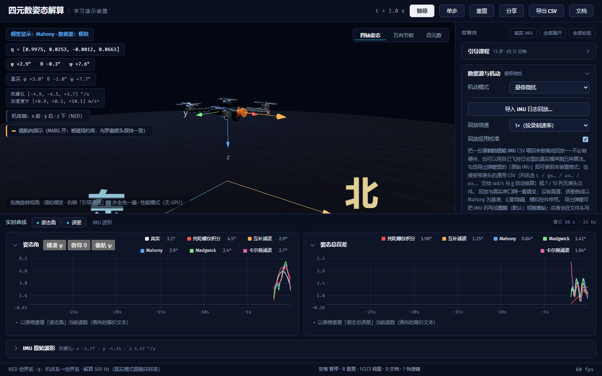
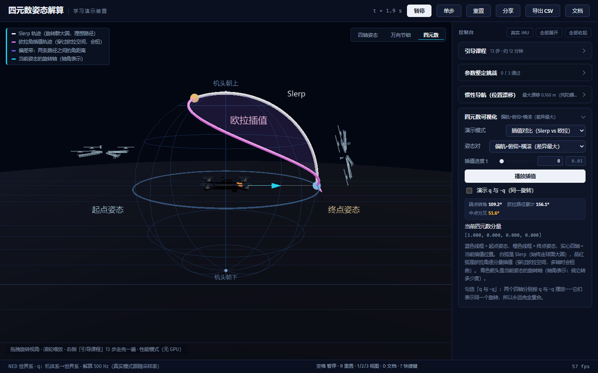

# 四元数姿态解算 · 学习演示装置

**[在线演示](https://fly_web.070616.xyz)** · **[源码](https://github.com/liuxiangfan/fly-web)** · [English](README.en.md)

把「四元数、姿态解算、卡尔曼滤波」从纸面公式变成可以拖动滑块的装置：五种算法同屏跑同一段 IMU 数据，
三块视图给出同一个姿态的三种读法，曲线与评测表把「谁在漂、漂多少」变成可复现的数字。

纯前端、零后端、零密钥——所有计算都在浏览器里完成。



## 它是什么

一架虚拟四轴，一套可调的传感器模型，五种姿态估计算法，和一份能按帧核对的真值。
改动任何一个 IMU 参数（零偏、噪声、交叉轴、延迟、采样率、磁干扰……）都会立刻反映到五条曲线的差异上；
「为什么这条发散、那条收敛」不需要猜，装置里带着可复现的剧本、可导出的数据和逐帧比对的工具。

配套的应用内教材覆盖从「为什么恰好是四个数」到「误差为什么按三次方长大」，每一条结论都能在装置里当场复现。

## 能做什么

- **五种算法同屏** —— 纯陀螺积分（漂移对照组）· 互补滤波 · Mahony · Madgwick · ESKF，同一份数据、同一时间基。
- **三种视图** —— 四轴姿态（含真值幻影与不确定度椭球）· 万向节锁（三环嵌套实测锁死）· 四元数（立体投影 + Slerp 对比）。
- **三条数据源** —— 可调传感器模型的模拟器（十种机动剧本）· 原始 IMU CSV 回放 · 真实器件直连（Web Serial / Web Bluetooth，含 MAVLink v2 RAW_IMU）。
- **校准闭环** —— 磁力计球拟合与完整椭球、加速度计六面校准、独立验证集、标定器件指纹与失效提示。
- **姿态到位置** —— 捷联力学编排给出北-东漂移轨迹，把姿态误差和位置误差的因果关系画出来。
- **可复现评测** —— 实验种子决定噪声与初值；配置档案可导出导入；多种子批量评测给出 P50/P95 与未收敛率，整批跑在 Web Worker 里、随时可取消。
- **单变量对照台** —— 冻结同一配置与种子，A/B 两次独立完整运行，只改变一个声明变量；显示完整配置差异、B−A 指标与可导出只读报告；教材结论可用「运行」按钮直接进入。
- **预测式练习** —— 5 道「先预测、再运行、后对照」的练习，证据来自固定 5 秒的离线复算，错误直觉会被实测结果直接反驳；结果区可导出含预测、证据、判定与反思的 JSON 学习记录。
- **当前任务与参数反馈** —— 装载实验或挑战后显示固定条件、唯一变量、观察目标和下一步；参数变化说明真实影响层与是否重置。
- **可观性与事件时间轴** —— 分轴误差、观测有效/拒绝/应用状态、保守解释；粗对准、门控拒绝与恢复按边沿记录，可点击定位到曲线时刻。
- **历史回看与 ESKF 单步解剖** —— 按需记录有界回看帧，只读覆盖 3D 展示；ESKF 可显式采集一次更新的预测、观测、门控、增益与协方差变化（含完整 6×6 P 矩阵开关）。
- **复盘导航** —— 一键跳到最大误差点与前后局部峰值，同帧呈现 ±0.25 s 内的真实事件、原始/消费 IMU 与观测状态；只给保守解释，不推断故障根因。
- **只读实验报告** —— 教学诊断分区一键生成含配置快照、五算法指标、事件与对照结果的报告，可导出 JSON、可打印；报告 JSON 可再导入只读查看，不应用配置、不改变当前运行。
- **文字三档与离线韧性** —— 标准/大/特大界面字号（本地持久化，非法值回退）；PWA 首次联网后懒加载功能全部可离线，发现新版本时显示确认横幅，点击「重新加载以更新」才切换。
- **应用内教材** —— 15 个分页、19 章数学原理、控制项手册、实验与练习、排障手册、术语索引与文献出处；结论旁的「运行」按钮可跳到实验，并在任务条一键返回原阅读位置与焦点。
- **可访问性** —— 全键盘操作与焦点归还、曲线的等价文本表格、色觉友好配色、窄屏目录折叠、标准/大/特大文字档位。

## 快速开始

**环境：Windows 10/11 + Node.js 22 + Chrome 或 Edge。**（真实串口／蓝牙只在这两个浏览器可用。）

```bash
git clone https://github.com/liuxiangfan/fly-web.git
cd fly-web
npm ci

npm run dev      # 开发服务器
npm run build    # 类型检查 + 构建到 dist/
npm run preview  # 预览构建产物（默认 4173 端口）
```

### 验证

```bash
npx tsc --noEmit   # 类型检查
npm run check      # 数值自检 + 场景几何 + HTML 契约 + 文档基准（0 FAIL 才算过）
npm run budget     # 产物体积预算
npm run smoke      # 真浏览器端到端 129 项（需先 build；驱动器会自己起停预览）
```

`npm run check` 之后还会跑独立契约链、状态一致性与证据索引校验；`npm run smoke` 用真实鼠标键盘驱动本机浏览器，
覆盖假串口／假 BLE 设备、导出→导入闭环、打印媒体、深链全控件往返、长跑容器封顶与 WCAG AA 对比度。

## 界面

| 视图 | 看什么 |
|---|---|
| **四轴姿态** | 解算姿态与真值幻影的实时差；磁航向、旋转轴、不确定度椭球；IMU 原始波形与误差曲线 |
| **万向节锁** | 三个环的嵌套关系；俯仰到 ±90° 时内外环共面，「少了一个自由度」是看得见的 |
| **四元数** | 单位球上的姿态点与 Slerp 路径；欧拉插值与四元数插值的轨迹差异 |



右侧控制台是可折叠的手风琴：数据源与机动、实验库、单变量对照、IMU、磁校准、算法参数、评测、惯性导航、挑战、引导课程……
每个滑块都配数值输入框，每个控件都能被分享链接带走。
装载实验或挑战后，控制台上方显示当前任务的固定条件、唯一变量、观察目标与下一步；参数变化会在轻量反馈条里说明真实影响层与是否重置。
文档「实验与练习」页内嵌 5 道预测练习：先锁定预测，再运行固定 5 秒的复算证据，最后对照解释。
打开右侧「玻璃盒」分区后，可观性、事件时间轴、历史回看与 ESKF 单步面板按需加载；回看记录与 ESKF 采集各有独立开关，默认不采样。回看面板的「最大误差 / 上一证据 / 下一证据」用于误差尖峰复盘。「教学诊断」分区可生成只读实验报告（导出 JSON / 打印）或导入报告 JSON 只读查看；「显示与配色」分区提供文字三档（Canvas 图表内文字不随档位缩放）。

## 技术栈

| 层 | 选择 |
|---|---|
| 构建 | TypeScript + Vite（three 单独拆 vendor chunk） |
| 3D | Three.js（唯一运行时依赖，程序化建模，无外部模型文件） |
| 图表 | 手写 Canvas 2D，无图表库 |
| 数学排版 | KaTeX 字体子集（不引入 KaTeX 运行时） |
| 字体 | Fira Sans / Fira Code 自托管子集，无外部 CDN |
| 框架 | 无（原生 DOM + 事件委托） |
| 后端 | 无（纯静态，所有计算在浏览器本地） |

## 项目结构

```
├── index.html          # 页面骨架、面板 UI 与全部文档内容（内联、可搜索、可打印）
├── src/
│   ├── main.ts         # 装配层：仿真 / 解算 / 场景 / UI / 文档 / 主循环
│   ├── core/           # 数值内核：四元数、估计器、runner、校准、回放、传输协议
│   ├── scene/          # 三维场景：四轴、万向环、四元数视图、标签
│   ├── ui/             # 面板、图表、引导课程、文档搜索
│   └── workers/        # 批量评测 Worker
├── scripts/            # 自检、契约、冒烟、长稳、预算与证据校验
├── docs/               # 项目状态、验证证据、性能方案与生成的报告
└── firmware/           # 参考固件的帧协议与接线说明（硬件不在本阶段范围）
```

## 质量与验证

<!-- facts:begin -->
| 门禁 | 实测 |
|---|---|
| `npm run check` | 155 项：数值自检 126 + 场景几何 10 + HTML 契约 15 + 文档基准 4，另有独立契约链与证据索引校验 |
| 浏览器端到端 | 129 项浏览器冒烟（app 108 + devices 21），真浏览器、真鼠标键盘 |
| 体积预算 | 19 项产物预算，名义上限 × 90% 作有效门槛，不随改动放宽 |

<!-- verify: check=155 contracts=yes status=yes smoke=129 budget=19 evidence=yes -->
<!-- facts:end -->

证据按「源码摘要 + 产物摘要 + buildId」三层绑定，报告与索引交叉核对；细节见
[docs/VERIFICATION-EVIDENCE.md](docs/VERIFICATION-EVIDENCE.md) 与 [docs/PROJECT-STATE.md](docs/PROJECT-STATE.md)。

## 兼容性与已知限制

- **只针对 Windows 本机**（Chrome / Edge）。Firefox 与 Safari 没有 Web Serial / Web Bluetooth，页面会明确说明。
- **硬件不在本阶段范围**：串口与 BLE 链路用软件替身（按真实帧协议发帧、按真实 GATT 分片通知）做端到端验证，未接实物验收。
- **无 GPU 加速时自动降画质**：检测到软件光栅化（SwiftShader / llvmpipe / 基础显示驱动）会关闭 MSAA、阴影与环境贴图，
  以保证可交互；有 GPU 的机器画质不变。控制台会说明原因，可用 `attitudeDemo.renderQuality()` 查询当前档位。
- **离线与更新**：Service Worker 预缓存应用外壳，首次联网访问后全部懒加载功能可离线使用（从未访问过的首次离线不承诺）；新版本不会自动接管，需点击更新横幅手动确认。Canvas 图表内文字由 JS 绘制，不随文字档位缩放。
- **读屏不在本阶段范围**：项目所有者明确不需要读屏功能。自动验收仍覆盖可访问名称、焦点顺序、对比度与等价文本，但不声称完成真实读屏软件验证。

## 文档

- 应用内：15 个分页的教材、控制项手册与排障手册（右上角「文档」，或 <kbd>Ctrl</kbd>+<kbd>K</kbd> 全文搜索）
- 仓库内：[项目状态](docs/PROJECT-STATE.md) · [验证证据](docs/VERIFICATION-EVIDENCE.md) · [质量复核历史](docs/QUALITY-AUDIT-HISTORY.md) ·
  [改进方案](docs/SOFTWARE-IMPROVEMENT-PLAN.md) · [性能优化方案](docs/WINDOWS-PERFORMANCE-OPTIMIZATION-PLAN.md) ·
  [可访问性验收](docs/ACCESSIBILITY-ACCEPTANCE.md) · [变更日志](docs/CHANGELOG.md) · [教学功能与交互扩展实施方案](docs/TEACHING-INTERACTION-EXPANSION-PLAN.md)

## 贡献

提交前请跑通上面的「验证」四条命令；改动判据或阈值时需要说明旧判据的盲区与新增的正反例，
不接受用放宽门槛换绿色。

## 许可

本仓库未附带开源许可证文件。如需在课程或项目中复用，请先开 issue 说明用途。
